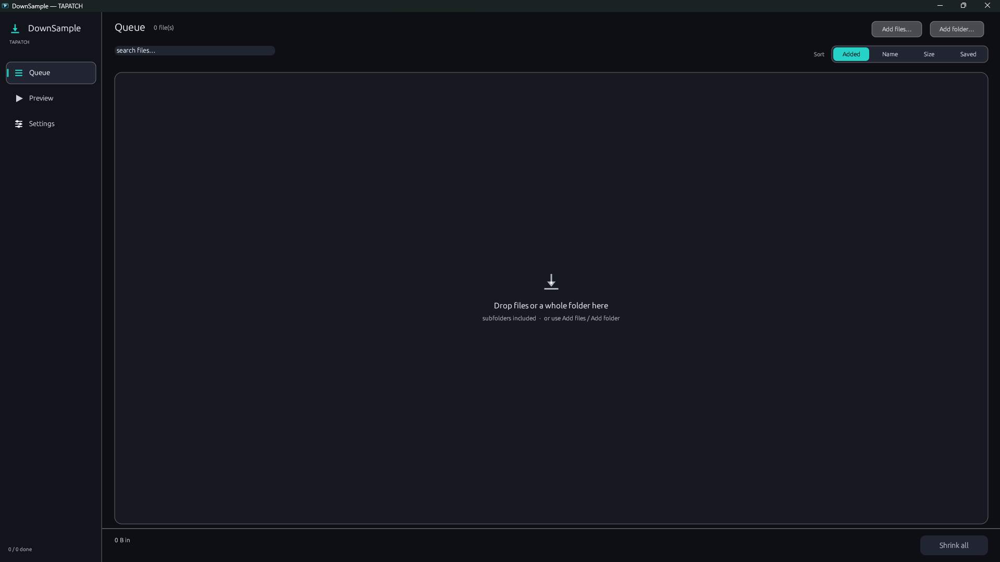
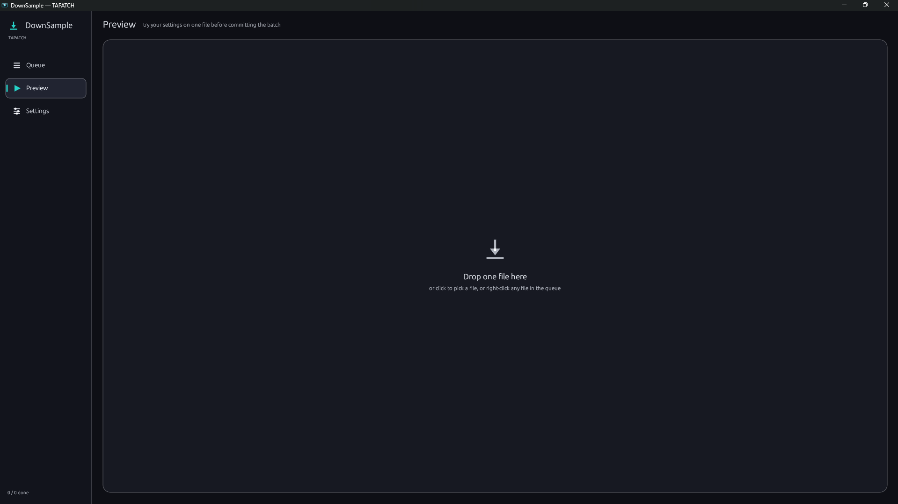
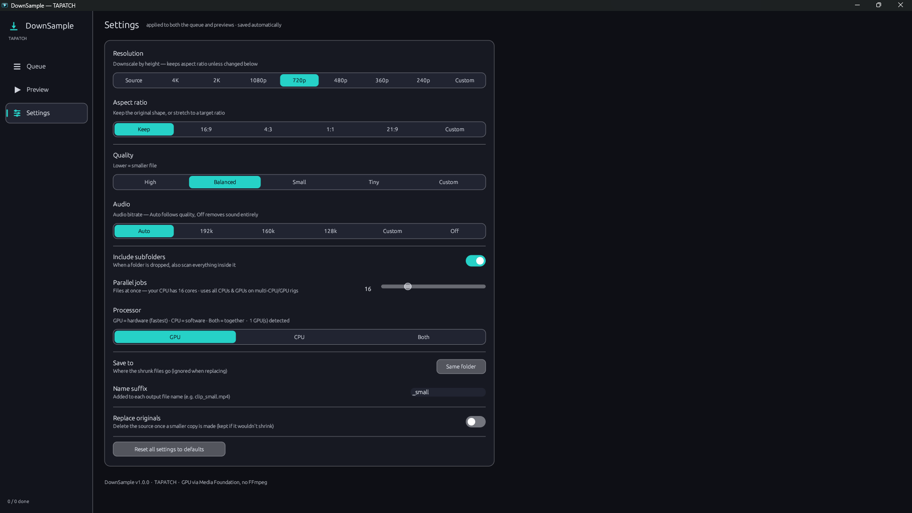

<p align="center"></p>
<h1 align="center">DownSample</h1>
<p align="center"><b>Shrink any video or audio. GPU-fast, no FFmpeg.</b></p>
<p align="center">Video & Audio Shrinker · Windows 10/11 · x64 · ~4 MB · Free for personal use</p>
<p align="center"><a href="https://github.com/tapatchUSA/DownSample/releases/latest"><b>⬇ Download DownSample 1.0.4</b></a> &nbsp;·&nbsp; <a href="https://tapatch.com/tools/downsample/">tapatch.com/tools/downsample</a></p>

<p align="center">
<br>
 
</p>

> Built because every 'small file' tool either bundles FFmpeg, uploads your video, or chokes through a folder one file at a time. DownSample uses the GPU encoder Windows already ships and runs the whole queue in parallel.

## What it does

DownSample shrinks videos and audio to save disk space — without FFmpeg and without uploading anything. It drives Windows Media Foundation — the OS's own licensed H.264 / AAC — and encodes on your GPU's hardware blocks (NVIDIA, AMD, or Intel iGPU) via Direct3D 11. Drop in files or a whole folder, pick a target height (4K down to 240p or custom), aspect ratio, quality, and audio bitrate, then shrink the entire queue in parallel across every CPU and GPU you have. Preview your settings on a single file first, keep or replace originals, and add a name suffix. No bundled codec, no network, no telemetry — your media never leaves the machine.

## Features

A full batch transcoder in one tiny binary. Here are the highlights.

**⚡ GPU hardware encode**  
Encodes on your GPU's dedicated video block via Windows Media Foundation + Direct3D 11 — NVIDIA, AMD, or Intel iGPU. Run on GPU, CPU, or both together.

**🚫 No FFmpeg, no upload**  
Uses the H.264 / AAC codecs Windows already licenses — nothing bundled, nothing installed, nothing sent anywhere. Fully offline.

**📐 Resolution + aspect**  
Downscale by height — 4K, 2K, 1080p, 720p, 480p, 360p, 240p, or custom — keeping aspect ratio or stretching to 16:9, 4:3, 1:1, 21:9, or your own.

**🎚️ Quality + audio control**  
High / Balanced / Small / Tiny quality presets and audio bitrate from Auto down to off — dial the size-versus-quality trade-off exactly.

**📦 Parallel batch queue**  
Drop a whole folder (subfolders included) and shrink every file at once across all your CPU cores and GPUs. Sort by added, name, size, or space saved.

**👁️ Preview before committing**  
Try your settings on one file first and see the result before running the whole batch. Keep originals or replace them once a smaller copy is made.

## Limitations

- Windows 10/11 only. Encodes the formats Windows Media Foundation supports (H.264 / HEVC video, AAC audio in MP4/MOV and common containers); exotic or patent-encumbered formats without a Media Foundation codec aren't covered. Hardware-encode quality depends on your GPU's encoder.

## What's new in 1.0.4

- Replace originals: the original is only removed once its smaller copy is safely in place
- Two files that end up with the same name (movie.mkv and movie.avi) no longer overwrite each other: the second one becomes "movie (2).mp4"
- Never writes over a file that's already there

Release notes for every version are on the [Releases](https://github.com/tapatchUSA/DownSample/releases) page and in [release-notes/](release-notes/).

## Install

1. Download **DownSample-Setup-1.0.4.exe** from the [latest release](https://github.com/tapatchUSA/DownSample/releases/latest) or from [tapatch.com](https://tapatch.com/tools/downsample/).
2. Run it. The installer and the app come in 10 languages.
3. Accept the Terms of Service on first launch.

Windows may show a SmartScreen warning for new downloads. Click **More info → Run anyway**.

Or with [Scoop](https://scoop.sh):

```powershell
scoop bucket add tapatch https://github.com/tapatchUSA/packages
scoop install tapatch/downsample
```

## All versions

| Version | Released | Installer | VirusTotal | SHA-256 |
|---|---|---|---|---|
| [1.0.4](https://github.com/tapatchUSA/DownSample/releases/tag/v1.0.4) | 2026-10-18 | [DownSample-Setup-1.0.4.exe](https://github.com/tapatchUSA/DownSample/releases/download/v1.0.4/DownSample-Setup-1.0.4.exe) | [1 / 71](https://www.virustotal.com/gui/file/8b484b062e3ddaab2ea73cd4da2ae0952f46de229a12a668808ba4df07c4a652/detection) | `8b484b062e3ddaab…` |
| [1.0.3](https://github.com/tapatchUSA/DownSample/releases/tag/v1.0.3) | 2026-10-17 | [DownSample-Setup-1.0.3.exe](https://github.com/tapatchUSA/DownSample/releases/download/v1.0.3/DownSample-Setup-1.0.3.exe) | [1 / 70](https://www.virustotal.com/gui/file/6db8b47042761b2b195e3d9f177d03a40a196d1cdc9a10a75645110cde3525b6/detection) | `6db8b47042761b2b…` |
| [1.0.2](https://github.com/tapatchUSA/DownSample/releases/tag/v1.0.2) | 2026-10-01 | [DownSample-Setup-1.0.2.exe](https://github.com/tapatchUSA/DownSample/releases/download/v1.0.2/DownSample-Setup-1.0.2.exe) | [1 / 70](https://www.virustotal.com/gui/file/ba0d3fc38c564ae9ed2074a2cba16bd910b012edf9a3ddde53cd13de067c8eeb/detection) | `ba0d3fc38c564ae9…` |
| [1.0.1](https://github.com/tapatchUSA/DownSample/releases/tag/v1.0.1) | 2026-09-30 | [DownSample-Setup-1.0.1.exe](https://github.com/tapatchUSA/DownSample/releases/download/v1.0.1/DownSample-Setup-1.0.1.exe) | [2 / 70](https://www.virustotal.com/gui/file/d51c6dc3eb2278dea16fc34a3454055b559465e64f51d20058e4833a658c2f8f/detection) | `d51c6dc3eb2278de…` |
| [1.0.0](https://github.com/tapatchUSA/DownSample/releases/tag/v1.0.0) | 2026-09-16 | [DownSample-Setup-1.0.0.exe](https://github.com/tapatchUSA/DownSample/releases/download/v1.0.0/DownSample-Setup-1.0.0.exe) | [1 / 71](https://www.virustotal.com/gui/file/a1fb71809ef00a69384ff226d37a0e8ce135b14cea8ab3ecbd3d79029567dbf1/detection) | `a1fb71809ef00a69…` |

## Security

Every installer is scanned on VirusTotal before release. DownSample 1.0.4: **1 / 71** engines flag it · [view report](https://www.virustotal.com/gui/file/8b484b062e3ddaab2ea73cd4da2ae0952f46de229a12a668808ba4df07c4a652/detection)

**SHA-256**
```
8b484b062e3ddaab2ea73cd4da2ae0952f46de229a12a668808ba4df07c4a652
```

## Built with

Rust · egui · eframe · Media Foundation · Direct3D 11

## License

Free for personal use. Business or commercial use requires a paid license (see [tapatch.com/terms](https://tapatch.com/terms/)). Full terms: [tapatch.com/terms/software](https://tapatch.com/terms/software/).

This repository holds the official installers and release notes.

---

**[tapatch.com](https://tapatch.com)**: small tools, serious quality. Built solo, shipped with care.
