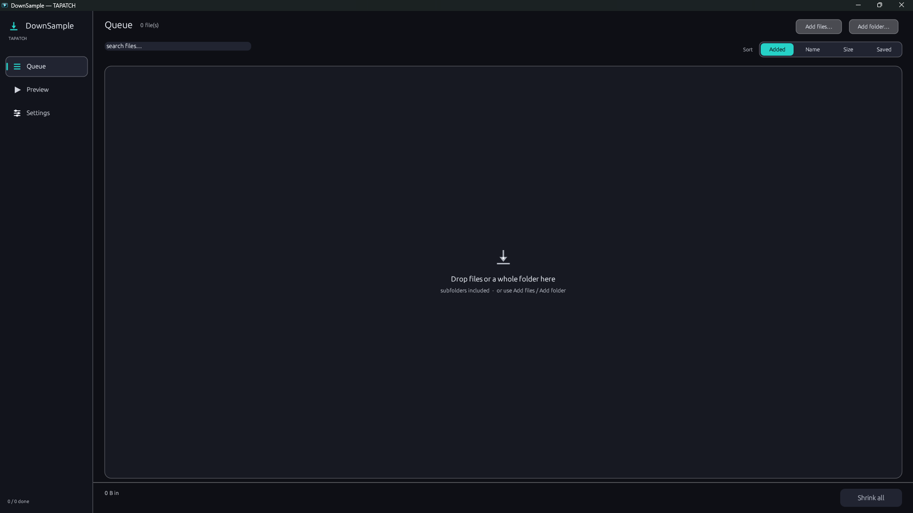
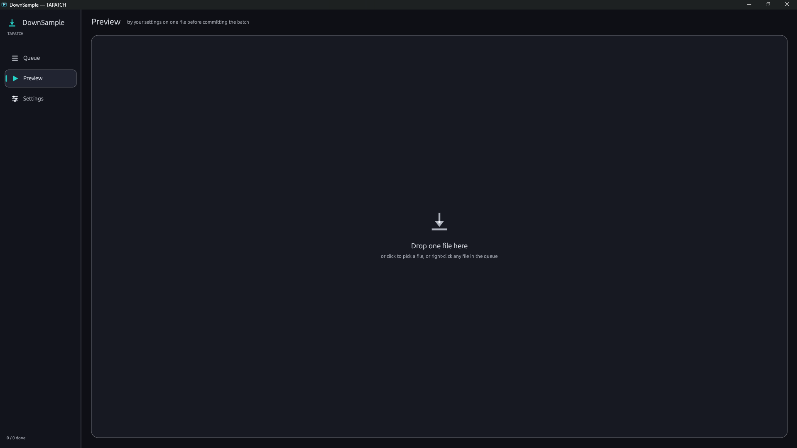
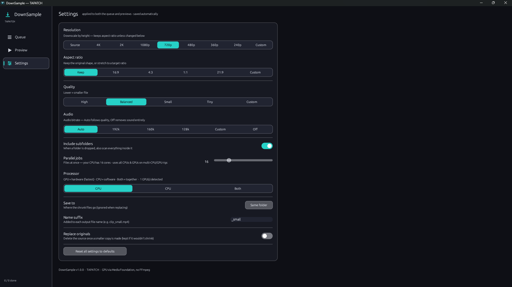

**DownSample 1.0.5** for Windows 10/11 (x64) · Free for personal use

### What's new

- New Theme setting: TAPATCH, Void, Neon, Ember, or Custom with your own colors
- Background pictures and GIFs: add as many as you like in Settings, tick the ones to show (or Select all), and the ticked ones take turns
- Sliders set how strong the picture is and how see-through the panels are; turn it off any time
- The installer's license text matches the current Terms, and THIRD-PARTY-NOTICES.txt lists the open-source parts it uses

### Screenshots

 
 

### Download

**`DownSample-Setup-1.0.5.exe`** is attached below. It is the same file as on [tapatch.com/tools/downsample](https://tapatch.com/tools/downsample/).

### Security

- VirusTotal: **1 / 71** engines flag it · [view report](https://www.virustotal.com/gui/file/e394f5e51794e88d4170735af461ad5c67979443849c1105ee581b5f7b23250e/detection)
- SHA-256: `e394f5e51794e88d4170735af461ad5c67979443849c1105ee581b5f7b23250e`

*First released on tapatch.com on 2026-11-04.*

---
Free for personal use. Business or commercial use requires a paid license (see [tapatch.com/terms](https://tapatch.com/terms/)).
