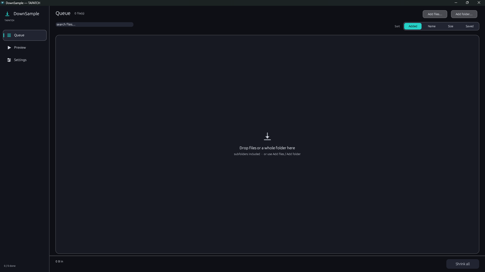
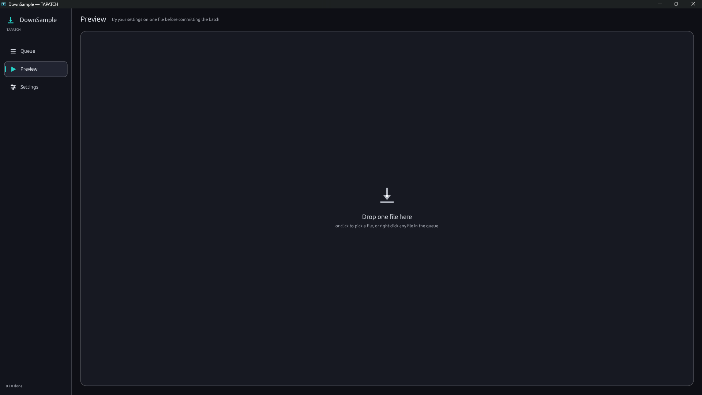
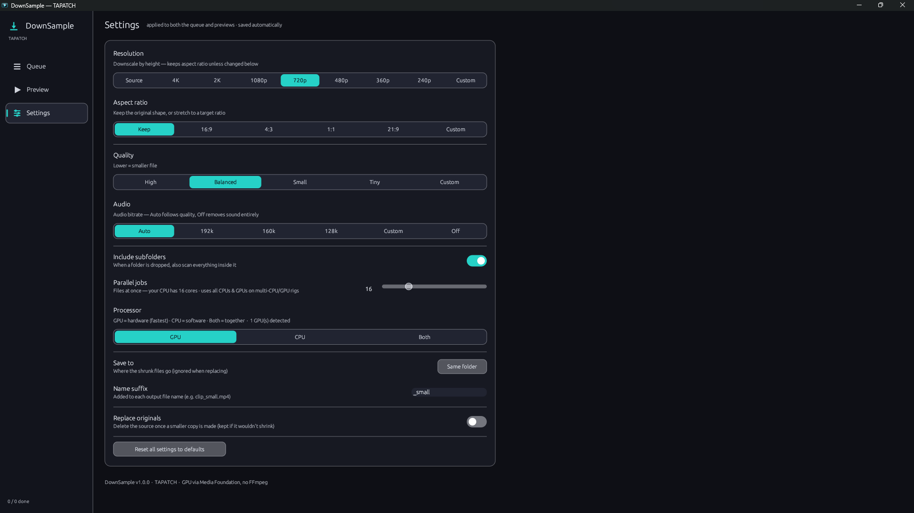

**DownSample 1.0.6** for Windows 10/11 (x64) · Free for personal use

### What's new

- The dot shown while a file is shrinking no longer appears as an empty box

### Screenshots

 
 

### Download

**`DownSample-Setup-1.0.6.exe`** is attached below. It is the same file as on [tapatch.com/tools/downsample](https://tapatch.com/tools/downsample/).

### Security

- VirusTotal: **1 / 71** engines flag it · [view report](https://www.virustotal.com/gui/file/d30e633dfb1c43f886d4d055ca30de28fcd2ad8b3233f9d53678d89e9674bebd/detection)
- SHA-256: `d30e633dfb1c43f886d4d055ca30de28fcd2ad8b3233f9d53678d89e9674bebd`

*First released on tapatch.com on 2026-11-07.*

---
Free for personal use. Business or commercial use requires a paid license (see [tapatch.com/terms](https://tapatch.com/terms/)).
