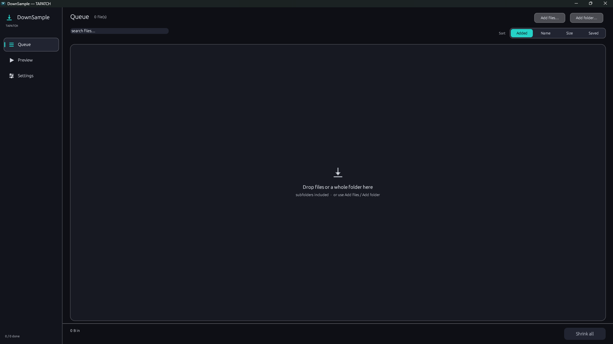
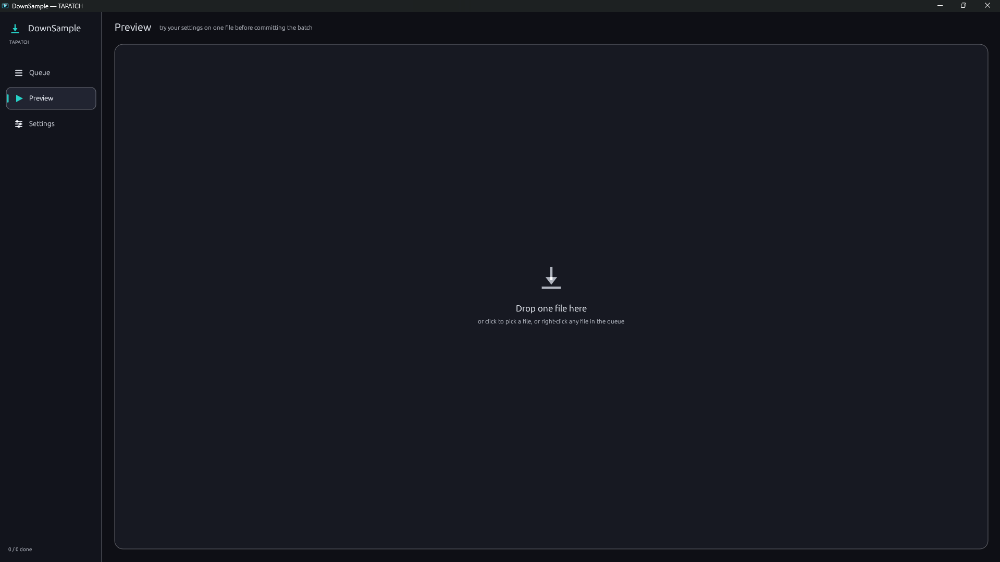
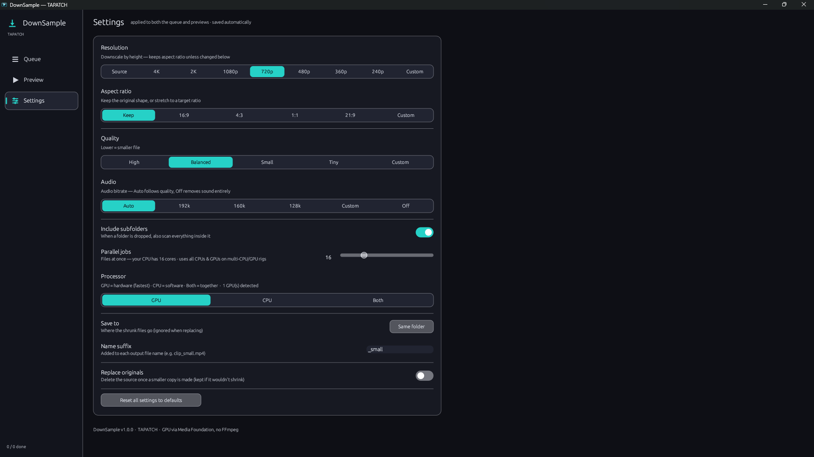

**DownSample 1.0.7** for Windows 10/11 (x64) · Free for personal use

### What's new

- Now opens in virtual machines, Remote Desktop and on PCs without a graphics driver: it switches to Direct3D 12 when OpenGL doesn't work
- If the window still can't open, a message says why instead of the app closing without a word

### Screenshots

 
 

### Download

**`DownSample-Setup-1.0.7.exe`** is attached below. It is the same file as on [tapatch.com/tools/downsample](https://tapatch.com/tools/downsample/).

### Security

- VirusTotal: **1 / 71** engines flag it · [view report](https://www.virustotal.com/gui/file/87281f6fc9f9951f0b1e8662c464a4b5ec75e23cadb7322ecb5186ac9e35977d/detection)
- SHA-256: `87281f6fc9f9951f0b1e8662c464a4b5ec75e23cadb7322ecb5186ac9e35977d`

*First released on tapatch.com on 2026-11-11.*

---
Free for personal use. Business or commercial use requires a paid license (see [tapatch.com/terms](https://tapatch.com/terms/)).
